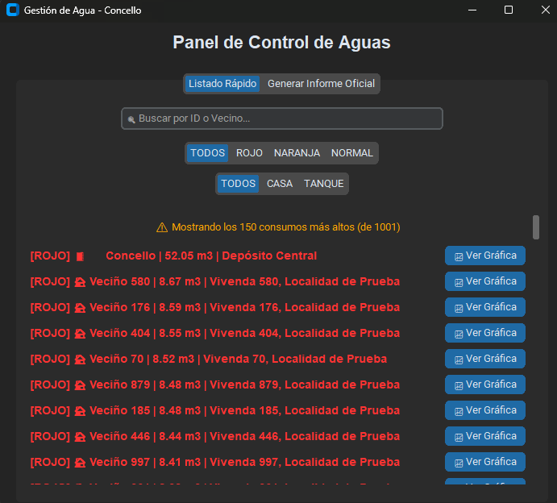
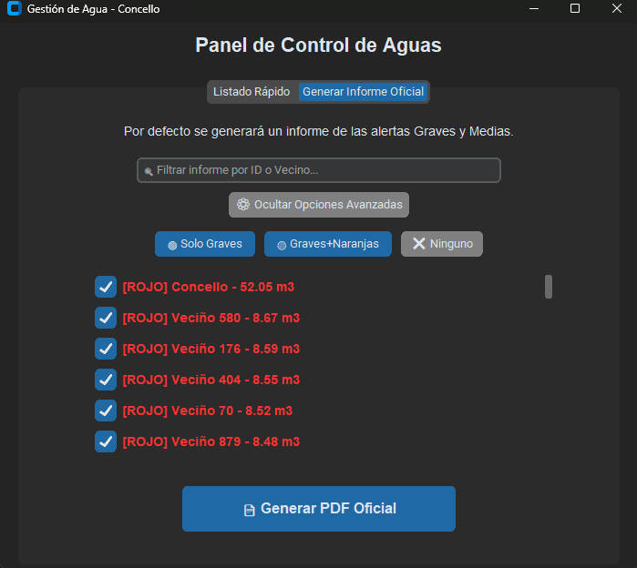
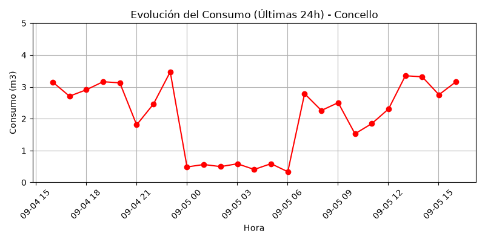

# 💧 Smart Water Alert System (IoT Simulation)

Aplicación de escritorio desarrollada para la monitorización, auditoría y detección de anomalías en la red de abastecimiento de aguas de un municipio local. 

El sistema analiza el consumo en tiempo real de cientos de contadores, clasificando el riesgo mediante lógica paramétrica y generando informes oficiales automatizados con gráficas de consumo.

## 🚀 Características Principales (Features)

*   **Generador de Datos Realistas (*Mock Data Profiling*):** Incluye un script (`generador_datos.py`) que simula 1.000 contadores durante 24 horas. Genera patrones matemáticos de consumo realistas: *Goteo constante, Fuga progresiva, Riego nocturno, Rotura súbita o Uso de piscina*.
*   **Interfaz Gráfica Moderna:** UI responsiva desarrollada con `CustomTkinter` (soporte Modo Oscuro/Claro), con búsqueda en tiempo real e iteración dinámica de widgets.
*   **Generación de Informes en PDF:** Creación de documentos oficiales (`FPDF`) incrustando gráficas vectoriales del histórico de consumo de cada usuario (`Matplotlib`).
*   **Procesamiento Paralelo (*Multiprocessing*):** Para evitar cuellos de botella al exportar cientos de gráficas, el sistema utiliza `concurrent.futures.ProcessPoolExecutor`, aprovechando todos los núcleos de la CPU para renderizar las imágenes en segundo plano.
*   **UI Asíncrona (*Multithreading*):** Delegación de las tareas pesadas de I/O a hilos secundarios (`threading.Thread`) para garantizar que la interfaz gráfica nunca se congele (*No UI blocking*).

## 📸 Interfaz y Resultados (Screenshots)

### 1. Panel de Monitorización y Filtros

### 2. Informe PDF de Alerta Generado

## 🛠️ Tecnologías y Arquitectura
*   **Backend & Lógica:** Python
*   **Base de Datos:** SQLite3 (Estructura relacional: Contadores, Lecturas, Alertas).
*   **GUI:** CustomTkinter
*   **Renderizado & Documentos:** Matplotlib (Motor `Agg` headless), FPDF.

## ⚙️ Instalación y Uso (How to run)

1. Clona este repositorio en tu máquina local:
   git clone https://github.com/adriglezdevesa/Smart-Water-Alert-System.git

2. Instala las dependencias necesarias:
    pip install -r requirements.txt

3. Genera la base de datos simulada (crea las tablas e inserta 1.000 clientes con patrones de consumo aleatorios):
    python src/generador_datos.py

4. Ejecuta el Panel de Control:
    python src/interfaz.py